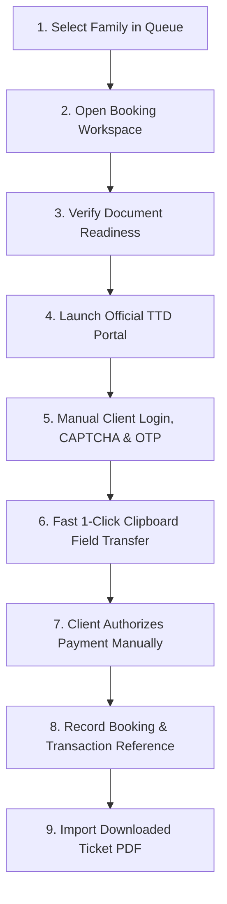

# SRIVANI BOOKING MANAGER v5.0.0
# Booking Workflow & Assisted Operation Guide

## 1. Official Compliance Notice & Boundaries

> [!IMPORTANT]
> The **SRIVANI BOOKING MANAGER** is strictly an administrative assistant tool.
> - **Client Manual Authorization**: Official TTD portal login, CAPTCHA solutions, SMS OTP verifications, and payment authorizations must be manually executed by the operator or client.
> - **No Bot Automation**: This software does NOT bypass queues, automate payment submission, or solve website challenges.
> - **Credential Security**: Never store TTD portal passwords, OTPs, UPI PINs, or banking passwords in this or any software.

---

## 2. Step-by-Step Assisted Booking Workflow

---

## 3. Detailed Step Walkthrough

### Step 1: Select Family in Priority Queue
- On the dashboard queue table, identify the next family at the top of the queue with status **Pending**.
- Double-click the family or click **"⚡ Family Workspace"** in the sidebar.

### Step 2: Open Dedicated Family Booking Workspace
The Family Workspace dialog surfaces critical details in one consolidated view:
- **Family Code & Name**: e.g., `FAM-20261114-A1B2 - Rao Family`
- **Primary Contact & Phone**: Instant phone reference.
- **Quota & Preferred Date**: e.g., `Advance Quota - 2026-12-25`
- **Calculated Donation**: ₹10,000 donation per devotee + ₹500 VIP break darshan ticket fee per devotee.

### Step 3: Check Document Readiness Assessment
- The application automatically verifies that every devotee in the roster has:
  1. A valid ID proof type (`Aadhaar`, `Voter ID`, `Passport`, etc.)
  2. Exactly 4 digits recorded in the `ID Proof Last 4` field.
  3. Valid age within bounds (0–120 years).
- If all pilgrims meet requirements, the badge shows **"✅ Ready for TTD Submission"**.
- If any details are missing, click **"Edit Devotee Details"** to complete them before proceeding.

### Step 4: Open Official TTD Portal
- Click the prominent blue button: **"🌐 Open Official TTD Website"**.
- The software launches the official TTD portal (`https://ttdevasthanams.ap.gov.in`) in your default web browser (Edge, Chrome, or Firefox).

### Step 5: Manual Client Login & Authentication
- In the browser, enter the registered mobile number.
- Solve the official CAPTCHA challenge manually.
- Enter the one-time password (SMS OTP) received on the donor's mobile phone.
- Navigate to the **Srivani Trust Donation / Break Darshan** booking section.

### Step 6: Fast Assisted Data Transfer (1-Click Clipboard Helpers)
- Click **"🚀 Assisted Booking Assistant"** to open the compact floating assistant window.
- The assistant stays alongside your browser window:
  - Click **"📋 Copy Name"** -> Paste into the portal name box (`Ctrl + V`).
  - Click **"📋 Copy Phone"** -> Paste into mobile number box.
  - Click **"📋 Copy Email"** -> Paste into email box.
  - Click **"📋 Copy Devotee Summary"** -> Paste the entire pilgrim roster into notes if needed.
- Each pilgrim has dedicated buttons:
  - `📋 Name` | `📋 Age` | `📋 ID Type` | `📋 Last 4 Digits`
- This completely eliminates manual typing errors and saves valuable seconds during quota releases!

### Step 7: Client Authorizes Payment Manually
- Review the total donation and darshan fee on the official portal.
- The client/donor selects their preferred payment mode (NetBanking, UPI, or Debit/Credit card) and authorizes the payment directly on the official bank gateway.
- *Never enter bank PINs or passwords into any third-party tool.*

### Step 8: Record Booking Result
Once the transaction succeeds on the portal:
- Switch back to the SRIVANI BOOKING MANAGER workspace.
- Click **"Update Status & Payment"**.
- Set **Booking Status** to **`Booked`**.
- Set **Payment Status** to **`Paid`**.
- Enter the **Transaction Reference / UTR Number** from the official portal receipt.
- The family's queue position is updated, and the event is timestamped in the audit history.

### Step 9: Import Downloaded Ticket PDF
- Download the generated PDF receipt / darshan ticket from the TTD website.
- In the workspace, click **"📥 Import Downloaded Ticket PDF"**.
- Select the downloaded file.
- The application automatically copies and indexes the file under:
  `data/tickets/<family_code>/<family_code>_Ticket_<timestamp>.pdf`.
- Cryptographic duplicate protection ensures the same ticket cannot be accidentally assigned to another family.
