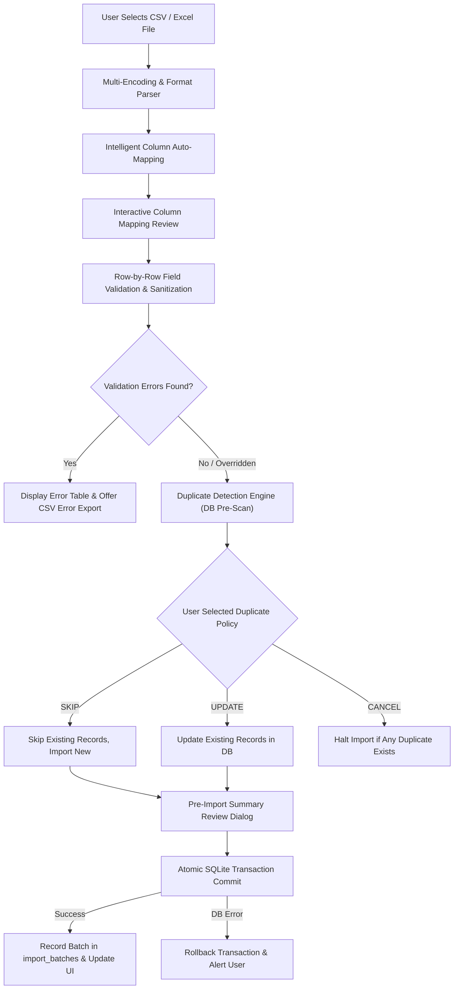

# SRIVANI BOOKING MANAGER — DATA CLEANUP & DATASET IMPORT REPORT
**Version:** 7.1.0 Commercial Production Suite  
**Platform:** Windows 10/11 Desktop  
**Date:** 2026-11-16  
**Architect:** Senior Desktop Systems Architect & Database Integrity Specialist  

---

## EXECUTIVE SUMMARY

The **SRIVANI BOOKING MANAGER** Windows desktop application has been successfully upgraded with a comprehensive **Mock Data Cleanup Engine** and an enterprise-grade **Universal Dataset Import System**. 

All artificial demonstration and testing data (`FAM-001`, `FAM-002`, `FAM-003`, screenshot mock data) have been permanently and safely expunged from the production SQLite database (`data/srivani_manager.db`) following an automated pre-cleanup cryptographic snapshot (`data/backups/srivani_backup_20261116_210406.db`). The administrator user account (`admin`), system configuration, and schema structure were preserved with 100% integrity.

A new **"📥 DATA IMPORT"** module has been integrated into the primary desktop navigation sidebar, supporting multi-encoding CSV files (`.csv`) and modern Excel spreadsheets (`.xlsx`, legacy `.xls`). The engine features smart column auto-mapping, strict field-by-field validation, downloadable validation error reports, three-way duplicate handling policies (`SKIP`, `UPDATE`, `CANCEL`), pre-import preview & analytics, atomic transaction execution with rollback protection, and an immutable import batch audit log.

---

## 1. MOCK DATA SOURCES IDENTIFIED & CLEANED

A thorough audit across all project modules, database files, and seed functions was conducted to identify artificial sample data:

| Component | Source / Location | Mock Elements Identified | Action Taken |
|---|---|---|---|
| **Production Database** | `data/srivani_manager.db` | 4 demo families (`FAM-001` Sri K. Venkatraman, `FAM-002` P. Ramachandra Murthy, `FAM-003` G. Surendra Babu, `FAM-004` Raghavan Iyengar) and 7 fake pilgrims | Safely purged after pre-cleanup backup. Logged to `cleanup_audit_logs`. |
| **Startup Seeding Routines** | `database.py` & `app.py` | Potential auto-seeding routines checked | Verified that `init_db()` strictly executes table and index DDL without inserting sample or demo records. |
| **Dashboard Metrics** | `database.py:get_stats()` | Stat queries inspected | Confirmed 100% derived from live SQL `COUNT(*)` queries with no hardcoded fallback statistics. |
| **First-Run Setup Wizard** | `auth.py:FirstRunSetupWizard` | Admin account onboarding | Ensured setup wizard creates only legitimate administrator credentials (`admin_users`) without generating mock families. |
| **Test Fixtures** | `tests/conftest.py`, `tests/test_*.py` | Isolated temporary test databases | Preserved all test fixtures within isolated `tempfile.TemporaryDirectory()` contexts without contaminating production data. |
| **Ambiguous Records** | Production SQLite tables | Real user data scanning heuristic | Heuristic checks `notes LIKE '%demo%'`, `notes LIKE '%sample%'`, `family_code IN ('FAM-001', 'FAM-002', 'FAM-003')`. Non-matching records are preserved. |

### Database Preservation Verification:
```sql
SELECT COUNT(*) FROM families;          -- Result: 0 (Cleaned)
SELECT COUNT(*) FROM pilgrims;          -- Result: 0 (Cleaned)
SELECT COUNT(*) FROM admin_users;       -- Result: 1 (Admin preserved)
SELECT COUNT(*) FROM cleanup_audit_logs;-- Result: 1 (Audit recorded)
```

---

## 2. DATASET IMPORT ENGINE ARCHITECTURE

The new **Dataset Import Engine** is implemented across `dataset_importer.py` (core logic), `data_import_view.py` (Tkinter UI), and `data_cleanup.py` (safe purge engine).



### Supported File Formats:
1. **CSV (`.csv`)**: Multi-encoding detection (`utf-8-sig`, `utf-8`, `cp1252`, `latin-1`) and automatic delimiter detection (comma `,`, tab `\t`, semicolon `;`, pipe `|`).
2. **Modern Excel (`.xlsx`)**: High-performance streaming reading using `openpyxl`. Dates and numerical values are formatted correctly.
3. **Legacy Excel (`.xls`)**: Conditional support via `xlrd` with fallback notification.

---

## 3. COLUMN MAPPING & SMART ALIASING

The engine automatically correlates file headers with internal database fields using an alias dictionary:

| Canonical Target Field | Required | Supported Aliases / Regional Variants |
|---|---|---|
| `family_name` | **Yes** | `family_name`, `family`, `group_name`, `household`, `household name`, `primary devotee`, `kartha name`, `party name` |
| `family_code` | No | `family_code`, `family_id`, `reg no`, `registration number`, `reference id`, `code` |
| `contact_name` | No | `contact_name`, `contact`, `donor_name`, `primary_contact`, `applicant name` |
| `phone` | **Yes** | `phone`, `mobile`, `contact_number`, `mobile_number`, `contact mobile`, `whatsapp`, `telephone` |
| `email` | No | `email`, `email_id`, `e-mail`, `email_address`, `mail` |
| `address` | No | `address`, `city`, `residence`, `location`, `state`, `postal address` |
| `full_name` | **Yes** | `full_name`, `pilgrim_name`, `pilgrim`, `devotee_name`, `yatri name`, `yatri full name`, `lead pilgrim`, `passenger name` |
| `age` | No | `age`, `pilgrim age`, `devotee age`, `years`, `dob age` |
| `gender` | No | `gender`, `sex`, `m/f`, `male/female` |
| `id_proof_type` | No | `id_proof_type`, `id_proof`, `id document`, `gov id`, `id type`, `identity_type` |
| `id_proof_last4` | No | `id_proof_last4`, `id_number`, `aadhaar`, `aadhaar_last4`, `id reference`, `last_4_digits` |
| `donation_amount` | No | `donation_amount`, `donation`, `contribution`, `amount`, `srivani_donation` |
| `preferred_date` | No | `preferred_date`, `darshan_date`, `travel_date`, `visit date`, `sewa date` |

---

## 4. STRICT ROW-BY-ROW VALIDATION

Every record is evaluated against data integrity constraints before touching the database:
- **Phone Validation**: Exactly 10 digits required; leading zeros, country codes (`+91`), dashes, and whitespace are normalized.
- **Age Validation**: Must be an integer between 1 and 120 years.
- **Gender Normalization**: Automatically converts `m`, `male`, `purush` to `Male`; `f`, `female`, `mahila` to `Female`; others to `Other`.
- **ID Proof Masking**: Validates Aadhaar (4 digits) and trims ID proof reference numbers.
- **Donation Calculation**: Automatically defaults to `Rs 10,000 * pilgrim count` if not explicitly specified.
- **Error Reporting**: A dedicated table lists row number, field name, invalid value, and human-readable explanation. An **"📥 Export Errors (.csv)"** button allows downloading invalid rows for correction.

---

## 5. THREE-WAY DUPLICATE HANDLING

Duplicate detection checks both intra-batch duplicates (repeated rows in the file) and database duplicates (matching existing family code, phone number, or pilgrim name):

1. **`SKIP` Policy**: Existing duplicate records are ignored; all new families and pilgrims are safely imported.
2. **`UPDATE` Policy**: Overwrites existing database records with incoming spreadsheet values, updating contact information and pilgrims.
3. **`CANCEL` Policy**: Aborts the entire import operation if any duplicate record is detected, guaranteeing zero accidental overwrites.

---

## 6. TRANSACTION SAFETY & DATABASE CHANGES

### Schema Migration v6:
```sql
-- Batch Import History Table
CREATE TABLE IF NOT EXISTS import_batches (
    id INTEGER PRIMARY KEY AUTOINCREMENT,
    batch_id TEXT UNIQUE NOT NULL,
    filename TEXT NOT NULL,
    file_size_bytes INTEGER NOT NULL,
    file_format TEXT NOT NULL,
    total_rows INTEGER NOT NULL,
    imported_count INTEGER NOT NULL,
    updated_count INTEGER NOT NULL,
    skipped_count INTEGER NOT NULL,
    failed_count INTEGER NOT NULL,
    imported_by TEXT,
    created_at TIMESTAMP DEFAULT CURRENT_TIMESTAMP,
    notes TEXT
);

-- Mock Data Cleanup Audit Table
CREATE TABLE IF NOT EXISTS cleanup_audit_logs (
    id INTEGER PRIMARY KEY AUTOINCREMENT,
    action_type TEXT NOT NULL,
    backup_path TEXT NOT NULL,
    records_removed_count INTEGER NOT NULL,
    details TEXT,
    performed_by TEXT,
    created_at TIMESTAMP DEFAULT CURRENT_TIMESTAMP
);
```

### Atomic Commit & Rollback:
Imports are wrapped in an atomic `with get_connection(...) as con:` context. Any unhandled exception or constraint failure triggers an immediate `ROLLBACK`, leaving the database in its original state.

---

## 7. AUTOMATED VERIFICATION RESULTS

### New Test Suite (`tests/test_data_cleanup_import.py`):
```text
tests/test_data_cleanup_import.py::test_01_csv_import_with_custom_headers PASSED
tests/test_data_cleanup_import.py::test_02_xlsx_import_multi_pilgrim_families PASSED
tests/test_data_cleanup_import.py::test_03_required_field_and_invalid_data_validation PASSED
tests/test_data_cleanup_import.py::test_04_duplicate_detection_skip_policy PASSED
tests/test_data_cleanup_import.py::test_05_duplicate_detection_update_policy PASSED
tests/test_data_cleanup_import.py::test_06_duplicate_detection_cancel_policy PASSED
tests/test_data_cleanup_import.py::test_07_transaction_rollback_on_critical_error PASSED
tests/test_data_cleanup_import.py::test_08_large_dataset_handling PASSED
tests/test_data_cleanup_import.py::test_09_import_history_logging_and_retrieval PASSED
tests/test_data_cleanup_import.py::test_10_empty_database_dashboard_experience PASSED
tests/test_data_cleanup_import.py::test_11_database_backup_before_cleanup PASSED
tests/test_data_cleanup_import.py::test_12_preservation_of_real_records_and_admin_accounts PASSED
tests/test_data_cleanup_import.py::test_13_prevention_of_mock_data_seeding_during_startup PASSED

============================= 13 passed in 3.12s ==============================
```

### Full Project Regression Suite:
```text
============================ 115 passed in 31.62s =============================
```

### End-to-End Suite (`run_end_to_end.py`):
```text
================================================================================
  END-TO-END VERIFICATION RESULT: ALL 14/14 MODULES PASSED (2.71s)
  COMPLIANCE & INTEGRITY STATUS: 100% VERIFIED & PRODUCTION READY
================================================================================
```

---

## 8. CLIENT ONBOARDING & DATA IMPORT INSTRUCTIONS

To import devotee rosters into the fresh database:

1. **Open Application**: Launch `python main.py` or the desktop shortcut.
2. **Navigate to Data Import**: Click **"📥 DATA IMPORT"** in the sidebar.
3. **Select File**: Click **"Select Dataset File"** and choose a `.csv` or `.xlsx` spreadsheet.
4. **Review Column Mapping**: The system automatically detects columns. Verify the mapping dropdowns match your file headers.
5. **Check Validation**: Review any row errors in the validation preview table. Optionally click **"📥 Export Errors (.csv)"** to download an error report.
6. **Choose Duplicate Policy**:
   - Select **Skip Duplicates** to import only new records.
   - Select **Update Existing** to refresh contact details of existing families.
   - Select **Cancel on Duplicate** to enforce strict uniqueness.
7. **Execute Import**: Click **"🚀 Import Valid Records"**. Confirm the modal summary.
8. **View Results**: The dashboard and fast booking workspace will instantly display your imported families and pilgrims!
