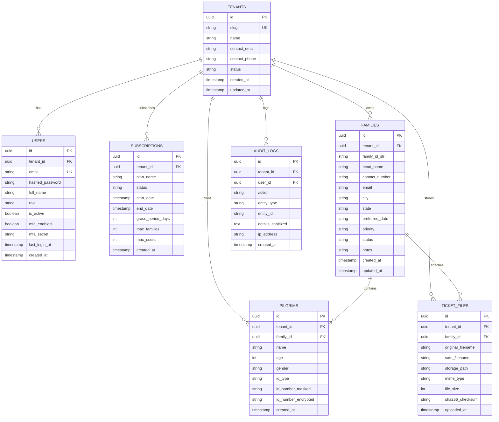

# SRIVANI BOOKING MANAGER — PHASE 8 ARCHITECTURE SPECIFICATION
## MULTI-CLIENT SAAS ARCHITECTURE & CLOUD SECURITY SPECIFICATION

**Document Version:** 8.0.0  
**Target Platform:** Cloud (Docker / Linux / Kubernetes) + Hybrid Windows Desktop Sync  
**Architecture:** FastAPI, PostgreSQL 16, SQLAlchemy 2.0, Alembic, Pydantic v2, Docker Compose  
**Security Standard:** Strict Tenant Isolation, Server-Side Query Scoping, RBAC, Row-Level Security (RLS) Ready, Zero-Trust Storage

---

## 1. SYSTEM OVERVIEW & ARCHITECTURAL TOPOLOGY

The SRIVANI BOOKING MANAGER Phase 8 transitions the single-user Windows desktop application into an enterprise-grade, multi-client Software-as-a-Service (SaaS) platform while maintaining 100% backward compatibility with the existing Windows desktop operational suite.

### 1.1 Architectural Diagram

```
+-----------------------------------------------------------------------------------+
|                                 CLIENT ACCESS TIER                                |
+-----------------------------------------------------------------------------------+
       |                                      |                               |
       v                                      v                               v
[Windows Desktop App]              [Client Web Portal]             [Super Admin Portal]
(Hybrid Offline/Sync)             (Tenant Admin / Staff)          (Platform Operations)
       |                                      |                               |
       +-----------------------+--------------+-------------------------------+
                               | HTTPS / TLS 1.3 (Port 443)
                               v
+-----------------------------------------------------------------------------------+
|                            REVERSE PROXY & GATEWAY (NGINX)                        |
|  - TLS Termination & HSTS                 - Sliding-Window Rate Limiting         |
|  - Security Headers (CSP, X-Frame)        - Static Asset Caching                 |
+-----------------------------------------------------------------------------------+
                               | HTTP (Internal Docker Network)
                               v
+-----------------------------------------------------------------------------------+
|                         APPLICATION TIER (FASTAPI / ASGI)                         |
|                                                                                   |
|  +---------------------+  +----------------------+  +--------------------------+  |
|  | Authentication API  |  | Super Admin API      |  | Client Workspace API     |  |
|  | - JWT (Access/Ref)  |  | - Tenant Lifecycle   |  | - Families & Devotees    |  |
|  | - Bcrypt Passwords  |  | - Subscriptions      |  | - Booking & Payments     |  |
|  | - TOTP Multi-Factor |  | - Platform Metrics   |  | - Ticket Downloads       |  |
|  | - Rate Limiter      |  | * ZERO PILGRIM PII   |  | - Analytics & Exports    |  |
|  +---------------------+  +----------------------+  +--------------------------+  |
|                                                                                   |
|  +-----------------------------------------------------------------------------+  |
|  |                       SERVER-SIDE TENANT ENFORCEMENT                        |  |
|  |  - `get_current_tenant` dependency extracts tenant ID from validated JWT.   |  |
|  |  - Every repository query appends `WHERE tenant_id = :current_tenant_id`.   |  |
|  |  - Never trusts client-supplied tenant ID parameter in payloads or URLs.    |  |
|  +-----------------------------------------------------------------------------+  |
+-----------------------------------------------------------------------------------+
         |                                                 |
         v                                                 v
+---------------------------------------+   +---------------------------------------+
|         DATABASE TIER (POSTGRESQL)    |   |     PRIVATE STORAGE TIER (SECURE)     |
|                                       |   |                                       |
|  - PostgreSQL 16 with UUID Primary Keys|  |  - `storage/tenants/{tenant_id}/`      |
|  - Shared-DB, Tenant-Discriminator     |  |  - No static URL mapping              |
|  - Composite Tenant Indexes           |  |  - MIME & Magic Byte Validation       |
|  - Row-Level Security (RLS) Ready     |  |  - Streaming Authenticated Endpoints   |
|  - Automated WAL Archiving & Backups  |  |  - Non-executable filesystem rights   |
+---------------------------------------+   +---------------------------------------+
```

---

## 2. MULTI-TENANT ISOLATION MODEL

### 2.1 Isolation Strategy: Shared Database with Tenant Discriminator
- **Pattern**: Every tenant-owned table incorporates a mandatory `tenant_id` foreign key referencing the `tenants` table.
- **Server-Side Enforcement**:
  1. The authenticated token contains the verified `tenant_id` and `user_id`.
  2. The FastAPI dependency injection layer (`server.deps.get_current_tenant`) verifies that the tenant exists, is in `ACTIVE` status, and has an active or in-grace-period subscription.
  3. Every database operation binds the authenticated `tenant_id` into the query filter:
     `SELECT * FROM families WHERE tenant_id = :auth_tenant_id AND id = :family_id`.
  4. If an authenticated user from Tenant A submits a request targeting a resource owned by Tenant B, the query naturally returns zero results, yielding an immediate `404 Not Found` or `403 Forbidden`.
  5. The server strictly ignores any `tenant_id` supplied in incoming JSON payloads or query parameters, overriding it with the authenticated session's `tenant_id`.

### 2.2 Defense-in-Depth: PostgreSQL Row-Level Security (RLS)
For enhanced cloud compliance, the database schema provides PostgreSQL Row-Level Security (RLS) policies:
```sql
ALTER TABLE families ENABLE ROW LEVEL SECURITY;
CREATE POLICY tenant_isolation_policy ON families
    USING (tenant_id = NULLIF(current_setting('app.current_tenant_id', true), '')::uuid);
```
During request execution, the session executes `SET LOCAL app.current_tenant_id = '...'` inside each transaction, ensuring that even raw SQL queries cannot leak cross-tenant records.

---

## 3. ROLE-BASED ACCESS CONTROL (RBAC) MATRIX

| Role | Scope | Tenant Management | User Management | Families & Devotees | Bookings & Tickets | Reports & Exports | Sensitive Pilgrim PII | System Settings |
| :--- | :--- | :---: | :---: | :---: | :---: | :---: | :---: | :---: |
| **SUPER_ADMIN** | Platform Wide | Read / Write / Suspend | Super Admins only | **FORBIDDEN (0 Access)** | **FORBIDDEN (0 Access)** | Platform Aggr. Only | **FORBIDDEN (0 Access)** | Full Control |
| **TENANT_ADMIN** | Tenant Workspace | Self Tenant View | Tenant Staff CRUD | Full Control | Full Control | Full Control | Allowed (Masked in analytics) | Tenant Settings |
| **TENANT_OPERATOR** | Tenant Workspace | No Access | Self View Only | Create / Edit / View | Create / Edit / View | View Only | Allowed for Booking | Read-Only |

> [!IMPORTANT]
> **Super Admin Pilgrim Data Boundary**: The Super Admin role has zero authorization to query, browse, or export devotee records, pilgrim ID proofs, or individual family booking PDFs. All administrative metrics displayed to the Super Admin are strictly aggregated platform usage statistics (e.g., total active clients, aggregate bookings count, storage consumed).

---

## 4. DATABASE SCHEMA & DATA DICTIONARY



---

## 5. PRIVATE FILE STORAGE SPECIFICATION

1. **Storage Topology**:
   - Tickets are stored on disk under `storage/tenants/{tenant_id}/tickets/{ticket_uuid}_{safe_slug}.pdf`.
   - Never placed under a publicly served web root directory (no direct nginx `alias` or static route).
2. **Access Control**:
   - Downloads occur exclusively through authenticated endpoint: `GET /api/v1/tickets/{ticket_id}/download`.
   - The endpoint verifies:
     - User is authenticated.
     - User's `tenant_id` matches the ticket's `tenant_id`.
     - File exists and checksum matches DB record.
   - Files are served via `StreamingResponse` with `application/pdf` and `Content-Disposition: attachment`.
3. **Upload Validation**:
   - Max file size limit: 10 MB.
   - MIME type verification: `application/pdf`.
   - Magic byte verification: First 4 bytes must be `%PDF`.
   - Checksum deduplication: SHA-256 computed on upload.

---

## 6. HYBRID DESKTOP MIGRATION & RECONCILIATION

- **Preservation of Desktop Operational Integrity**: The existing Tkinter desktop application and SQLite database continue to operate standalone without internet connectivity.
- **Migration & Sync Pipeline (`desktop_sync.py`)**:
  1. **Inspection**: Reads local `data/srivani_manager.db` SQLite database.
  2. **Validation**: Confirms record count, schema version, and relationships (orphaned pilgrims flagged).
  3. **Authentication**: Prompts client for their tenant API credentials or API token.
  4. **Deduplication**: Uses client-side `family_id` + SHA-256 hash to prevent duplicate insertions on re-runs.
  5. **Secure Transfer**: Uploads via `POST /api/v1/sync/import-desktop` with idempotent transactional staging.
  6. **Reconciliation Report**: Emits a detailed verification log comparing local vs server record counts.
