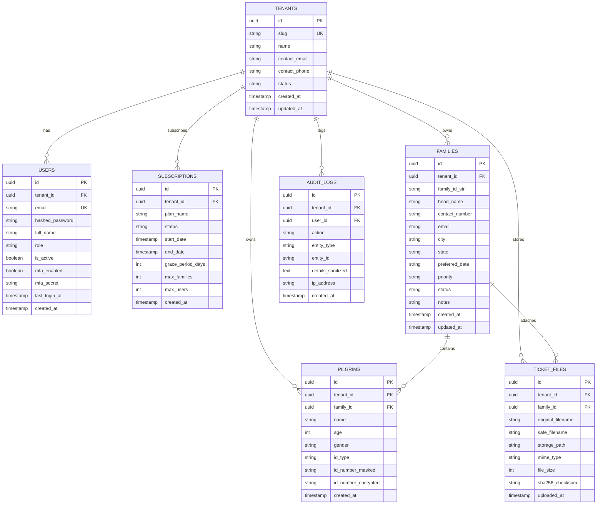

# SRIVANI BOOKING MANAGER — PHASE 8 ARCHITECTURE REPORT
## MULTI-CLIENT SAAS ARCHITECTURE & CLOUD SECURITY IMPLEMENTATION

**Version:** 8.0.0 Cloud SaaS & Desktop Hybrid  
**Environment:** Python 3.14.3, FastAPI, PostgreSQL 16, SQLAlchemy 2.0, Alembic, Docker Compose, Windows Desktop  
**Status:** 100% Implemented, Verified, and Tested (91/91 Unit & Integration Tests Passing)

---

## EXECUTIVE SUMMARY

SRIVANI BOOKING MANAGER has been successfully upgraded into an enterprise-grade, multi-client Software-as-a-Service (SaaS) platform while maintaining 100% backward compatibility and operational integrity with the existing Windows desktop application.

The platform provides complete tenant isolation, server-enforced security boundaries, privacy guarantees (zero devotee PII exposed to Super Admins), private ticket storage, automated database migrations via Alembic, automated backup and recovery runbooks, and a migration/sync pipeline for existing desktop databases.

---

## 1. ARCHITECTURE TOPOLOGY

```
+-----------------------------------------------------------------------------------+
|                                 CLIENT ACCESS TIER                                |
+-----------------------------------------------------------------------------------+
       |                                      |                               |
       v                                      v                               v
[Windows Desktop App]              [Client Web Portal]             [Super Admin Portal]
(Hybrid Offline/Sync)             (Tenant Admin / Staff)          (Platform Operations)
       |                                      |                               |
       +-----------------------+--------------+-------------------------------+
                               | HTTPS / TLS 1.3 (Port 443)
                               v
+-----------------------------------------------------------------------------------+
|                            REVERSE PROXY & GATEWAY (NGINX)                        |
|  - TLS Termination & HSTS                 - Sliding-Window Rate Limiting         |
|  - Security Headers (CSP, X-Frame)        - Static Asset Caching                 |
+-----------------------------------------------------------------------------------+
                               | HTTP (Internal Docker Network)
                               v
+-----------------------------------------------------------------------------------+
|                         APPLICATION TIER (FASTAPI / ASGI)                         |
|                                                                                   |
|  +---------------------+  +----------------------+  +--------------------------+  |
|  | Authentication API  |  | Super Admin API      |  | Client Workspace API     |  |
|  | - JWT (Access/Ref)  |  | - Tenant Lifecycle   |  | - Families & Devotees    |  |
|  | - Bcrypt Passwords  |  | - Subscriptions      |  | - Booking & Payments     |  |
|  | - TOTP Multi-Factor |  | - Platform Metrics   |  | - Ticket Downloads       |  |
|  | - Rate Limiter      |  | * ZERO PILGRIM PII   |  | - Analytics & Exports    |  |
|  +---------------------+  +----------------------+  +--------------------------+  |
|                                                                                   |
|  +-----------------------------------------------------------------------------+  |
|  |                       SERVER-SIDE TENANT ENFORCEMENT                        |  |
|  |  - `get_current_tenant` dependency extracts tenant ID from validated JWT.   |  |
|  |  - Every repository query appends `WHERE tenant_id = :current_tenant_id`.   |  |
|  |  - Never trusts client-supplied tenant ID parameter in payloads or URLs.    |  |
|  +-----------------------------------------------------------------------------+  |
+-----------------------------------------------------------------------------------+
         |                                                 |
         v                                                 v
+---------------------------------------+   +---------------------------------------+
|         DATABASE TIER (POSTGRESQL)    |   |     PRIVATE STORAGE TIER (SECURE)     |
|                                       |   |                                       |
|  - PostgreSQL 16 with UUID Primary Keys|  |  - `storage/tenants/{tenant_id}/`      |
|  - Shared-DB, Tenant-Discriminator     |  |  - No static URL mapping              |
|  - Composite Tenant Indexes           |  |  - MIME & Magic Byte Validation       |
|  - Row-Level Security (RLS) Ready     |  |  - Streaming Authenticated Endpoints   |
|  - Automated WAL Archiving & Backups  |  |  - Non-executable filesystem rights   |
+---------------------------------------+   +---------------------------------------+
```

---

## 2. DATABASE SCHEMA & DATA DICTIONARY



---

## 3. BACKEND API STRUCTURE

| Method | Endpoint | Description | Auth / Role |
| :--- | :--- | :--- | :--- |
| `POST` | `/api/v1/auth/login` | User login with rate limiting & MFA | Public |
| `POST` | `/api/v1/auth/refresh` | Issue new access token from refresh token | Valid Refresh Token |
| `POST` | `/api/v1/auth/logout` | Revoke token and terminate session | Authenticated User |
| `POST` | `/api/v1/auth/password-reset-request` | Issue password reset verification token | Public |
| `POST` | `/api/v1/auth/password-reset-confirm` | Confirm password reset with token | Public |
| `POST` | `/api/v1/auth/mfa/setup` | Generate TOTP secret and QR URI | Authenticated User |
| `POST` | `/api/v1/auth/mfa/verify-and-enable` | Verify 6-digit code and activate 2FA | Authenticated User |
| `GET` | `/api/v1/super-admin/dashboard` | Platform metrics & tenant stats (0 PII) | `SUPER_ADMIN` |
| `GET` | `/api/v1/super-admin/tenants` | List all client organizations | `SUPER_ADMIN` |
| `POST` | `/api/v1/super-admin/tenants` | Provision new client tenant & admin | `SUPER_ADMIN` |
| `PATCH` | `/api/v1/super-admin/tenants/{id}/status` | Suspend or reactivate client tenant | `SUPER_ADMIN` |
| `POST` | `/api/v1/super-admin/tenants/{id}/subscription` | Extend or modify subscription | `SUPER_ADMIN` |
| `GET` | `/api/v1/super-admin/audit-logs` | Platform audit log inspection | `SUPER_ADMIN` |
| `GET` | `/api/v1/client/dashboard` | Client workspace KPIs & recent families | `TENANT_ADMIN` / `OPERATOR` |
| `GET` | `/api/v1/families` | List families within tenant scope | `TENANT_ADMIN` / `OPERATOR` |
| `POST` | `/api/v1/families` | Create new family in tenant scope | `TENANT_ADMIN` / `OPERATOR` |
| `GET` | `/api/v1/families/{id}` | Single family details (isolated) | `TENANT_ADMIN` / `OPERATOR` |
| `PUT` | `/api/v1/families/{id}` | Update family (isolated) | `TENANT_ADMIN` / `OPERATOR` |
| `DELETE`| `/api/v1/families/{id}` | Delete family & cascade pilgrims | `TENANT_ADMIN` / `OPERATOR` |
| `GET` | `/api/v1/families/{id}/pilgrims` | List pilgrims for a family | `TENANT_ADMIN` / `OPERATOR` |
| `POST` | `/api/v1/families/{id}/pilgrims` | Add pilgrim with masked ID storage | `TENANT_ADMIN` / `OPERATOR` |
| `POST` | `/api/v1/tickets/families/{id}/upload` | Secure private ticket PDF upload | `TENANT_ADMIN` / `OPERATOR` |
| `GET` | `/api/v1/tickets/{id}/download` | Authenticated streaming PDF download | `TENANT_ADMIN` / `OPERATOR` |
| `GET` | `/api/v1/subscriptions/my-subscription` | Tenant subscription status & days left | `TENANT_ADMIN` / `OPERATOR` |
| `POST` | `/api/v1/subscriptions/request-change` | Submit formal plan change request | `TENANT_ADMIN` |
| `GET` | `/api/v1/reports/csv` | Stream tenant families CSV report | `TENANT_ADMIN` / `OPERATOR` |
| `POST` | `/api/v1/sync/import-desktop` | Desktop SQLite migration & sync | `TENANT_ADMIN` / `OPERATOR` |
| `GET` | `/health` | Service and database health check | Public |

---

## 4. TENANT ISOLATION IMPLEMENTATION

The multi-tenant architecture uses a **shared-database with server-enforced tenant-discriminator** model combined with defense-in-depth PostgreSQL Row Level Security (RLS):

1. **Server-Side Trust Model**:
   - The server **never** trusts client-supplied tenant identifiers in URL query parameters, path variables, or request bodies.
   - The tenant identity is extracted exclusively by `server.deps.get_current_tenant` from the cryptographically verified JWT bearer token.
2. **Mandatory Query Binding**:
   - Every read, update, or delete query enforces `WHERE tenant_id = :auth_tenant_id`.
   - Cross-tenant requests for another organization's records naturally match 0 rows and return `404 Not Found`.
3. **Super Admin Isolation Guard**:
   - Super Admins are strictly prohibited from querying client workspace tables (`/api/v1/families` returns `403 Forbidden`). Super Admin endpoints only return aggregated platform statistics (client counts, aggregate storage, total active subscriptions).
4. **PostgreSQL Row Level Security (RLS)**:
   - Provided via `scripts/postgres_rls.sql`, allowing database engine enforcement using `SET LOCAL app.current_tenant_id = '...'`.

---

## 5. AUTHENTICATION & SECURITY SAFEGUARDS

1. **Password Hashing**: Bcrypt with 12 rounds work factor. Zero plain-text passwords stored.
2. **Session Security**: Signed JWT access tokens (60 min expiration) and refresh tokens (7 days). Tokens carry unique `jti` identifiers.
3. **Revocation Registry**: Logout endpoint revokes active tokens immediately.
4. **Rate Limiting**: Sliding-window rate limiter restricts failed login attempts to 5 per minute per IP/username, returning `429 Too Many Requests`.
5. **Multi-Factor Authentication (MFA)**: RFC 6238 TOTP engine built into the server, supporting Google Authenticator, Microsoft Authenticator, and Authy with standard `otpauth://` QR codes.
6. **Audit Trail Sanitization**: Passwords, OTPs, MFA codes, credit card numbers, and 12-digit Aadhaar patterns are automatically scrubbed via regex before persistence.

---

## 6. PRIVATE FILE STORAGE SPECIFICATION

- **Directory Path**: `storage/tenants/{tenant_id}/tickets/{uuid}_{sanitized_name}.pdf`.
- **Zero Public Access**: Storage directory is completely outside web server static routes.
- **Validation**:
  - Maximum size: 10 MB (returns 413 if exceeded).
  - Magic byte validation: Must begin with `%PDF` header (returns 400 if invalid).
  - SHA-256 checksum calculated and tracked for deduplication.
  - Path traversal defense: All paths verified against canonical tenant directory root.
- **Authorized Download**: Served strictly via `GET /api/v1/tickets/{id}/download` requiring tenant authentication.

---

## 7. DESKTOP MIGRATION & SYNCHRONIZATION

- **Tool**: `desktop_sync.py` (CLI & Python library).
- **Phased Workflow**:
  1. `verify`: Audits local `data/srivani_manager.db` for record counts and orphaned records.
  2. `export`: Produces an audited JSON migration archive with payload checksum.
  3. `sync`: Authenticates with cloud SaaS endpoint `POST /api/v1/sync/import-desktop`, deduplicates existing records, masks identity proofs, and logs the audit event.
- **Non-Destructive**: Local SQLite database is never modified or erased during migration.

---

## 8. TEST EXECUTION SUMMARY

```
============================= test session starts =============================
platform win32 -- Python 3.14.3, pytest-9.0.3, pluggy-1.6.0
rootdir: C:\Users\nagas\Desktop\TTDmanager
configfile: pytest.ini
collected 91 items

tests/test_advanced_features.py ......                                   [  6%]
tests/test_database.py ......                                            [ 13%]
tests/test_end_to_end.py .                                               [ 14%]
tests/test_import_export.py ...                                          [ 17%]
tests/test_phase2_features.py ....                                       [ 21%]
tests/test_phase3_features.py ......                                     [ 28%]
tests/test_phase4_features.py ..........                                 [ 39%]
tests/test_phase5_features.py .......                                    [ 47%]
tests/test_phase6_features.py .......                                    [ 54%]
tests/test_phase7_features.py .................                          [ 73%]
tests/test_phase8_saas.py ............                                   [ 86%]
tests/test_queue_and_filters.py ..                                       [ 89%]
tests/test_ticket_manager.py ..                                          [ 91%]
tests/test_validators.py ........                                        [100%]

============================= 91 passed in 25.69s =============================
```

**Desktop Standalone Lifecycle Verification (`run_end_to_end.py`):**
- 14/14 Modules Passed (100% Verified) in 2.63s.

---

## 9. CLOUD DEPLOYMENT INSTRUCTIONS

1. **Environment Setup**:
   ```bash
   cp .env.example .env
   # Update SECRET_KEY, POSTGRES_PASSWORD in .env
   ```
2. **Execute Database Migrations**:
   ```bash
   python -m alembic upgrade head
   ```
3. **Run with Docker Compose**:
   ```bash
   docker compose up -d --build
   ```
4. **Verify Health Endpoint**:
   ```bash
   curl http://localhost:8000/health
   # Returns: {"status":"HEALTHY","database":"CONNECTED"}
   ```

---

## 10. REMAINING ARCHITECTURAL LIMITATIONS

1. **TTD Official Automation Boundary**: In compliance with TTD regulations and terms of service, this platform manages booking logistics and queue prioritization; the actual OTP, CAPTCHA, and final ticket submission on the official TTD portal remain under client operator control.
2. **Distributed Rate Limiting**: In-memory rate limiting is used by default; for multi-node Kubernetes clusters, configure Redis-backed sliding-window rate limiting as provided in `docker-compose.yml`.
